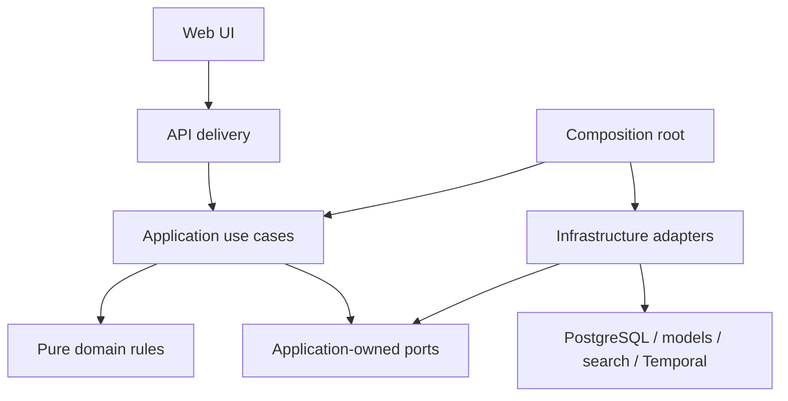
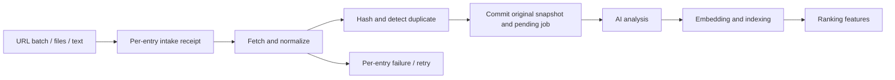
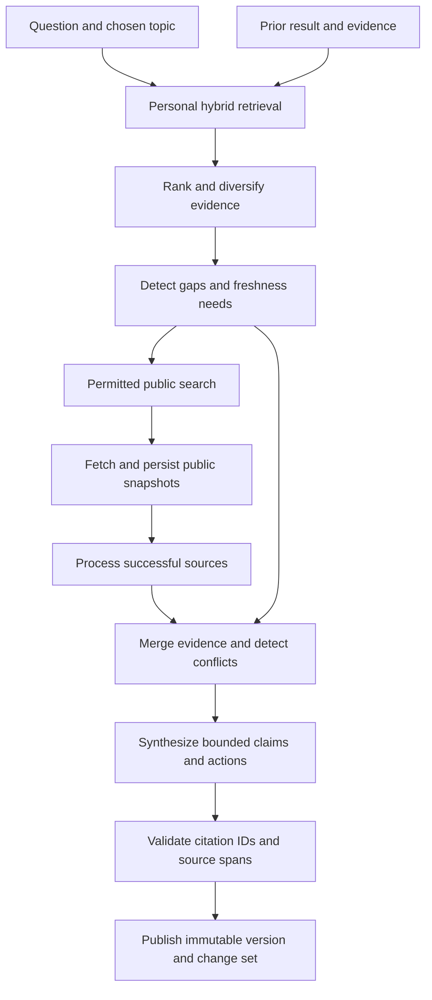
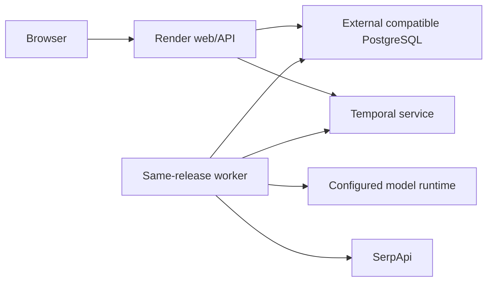

# Architecture

Approved target architecture. Tasks 1A/1B/2A/2B implement domain values/policies, durable intake, configurable source analysis, scoped lexical/optional vector retrieval, narrow ports, PostgreSQL adapters/migrations and composition wiring. Task 3A adds durable research runtime and immutable publication. API, UI and deployment remain planned. See [status](STATUS.md), [data contracts](DATA_MODEL.md), [partner boundaries](PARTNERS.md), and [decision records](ADRS/0001-modular-monolith.md).

## Style and dependency direction

Use a modular monolith with one codebase and shared application/domain rules. A web process and worker process may run the same release; these are execution roles, not independently owned microservices. Avoid an internal service network or generic event bus.

Target layout: `src/lazyresearch/domain/`, `application/`, `ports/`, `infrastructure/`, `api/`; composition root `bootstrap.py`; `ui/` and `tests/`. Domain, intake application/ports/adapters, bootstrap and tests currently exist. Within the first three layers use content, research, actions, and relevance modules as needed. Content owns captures and analysis; research owns missions/evidence/results; actions owns user task state; relevance owns interaction-derived ranking. Cross-module coordination belongs to application use cases; don't access another module's ORM tables directly.

Approved stack: Python 3.12 with standard-library domain values, Pydantic v2 for structured analysis boundaries, pytest/Ruff/mypy, SQLAlchemy 2.x/Alembic/psycopg 3, and future Streamlit UI with business logic outside it. PostgreSQL intake and source-analysis persistence are implemented; UI remains planned. The eventual public demo uses synthetic content.

Arrows above denote code dependency, except external calls from adapters. Runtime application-to-adapter calls use injected ports; domain never imports adapters or ports requiring I/O. Domain values use standard types; SDK response objects and ORM entities cannot cross inward. Bootstrap parses config, builds adapters, wires transaction scopes and use cases, and selects web or worker entry points. API authenticates and validates transport input, delegates, and maps errors; UI renders application DTOs without business rules.

## Ports sized to actual use cases

The table describes eventual conceptual contracts. Task 1A introduced ContentRepository, read-only ResearchRepository, ActionRepository, and provider-neutral errors. Task 1B added IntakeStore, ProcessingRepository, SourceFetcher and TextExtractor, plus SQLAlchemy content/intake/lease and HTTP/text/PDF adapters. Task 2A adds source-only AIProcessor and AnalysisStore for fenced runs and atomic analysis/proposal publication. Research synthesis/publication and mutable ActionItem persistence remain deferred. All operations carry owner scope; ORM objects never cross ports.

Implemented analysis: ProcessPendingContent claims configuration-specific jobs, loads immutable extractions, partitions bounded page-aware Unicode spans (also capped by a conservative UTF-8 context budget), and invokes AIProcessor outside transactions. Ollama is selected in bootstrap; no provider objects enter application/domain. Model-facing evidence IDs resolve through a request-local registry to exact stored chunk ranges. Pydantic forbids extra fields and permits uncertainty/insufficient information. At most one structural repair per chunk is recorded; invalid locators are not repaired. Deterministic assembly retains chunk summaries/claims and explicit COMPLETE/PARTIAL coverage. AnalysisStore publishes artifacts, relational evidence, proposals and successful run/job state in one short transaction; completed artifacts/attempts reject updates. Leases renew between bounded calls. Model/runtime revision snapshots are checked before inference where known; mutable tags still prevent a stronger reproducibility guarantee.

| Port | Minimal responsibilities / returned values | Initial adapter and fallback |
|---|---|---|
| AIProcessor | analyze source; synthesize bounded evidence; return schema-versioned analysis/claims/action candidates and model metadata | Configurable Gemma; compatible provider or pending state |
| RankingModel | predict four-class scores from versioned features and labeled context; report model version and baseline flag | TabPFN; deterministic baseline |
| SearchProvider | public search(query, locale, budget); return URLs, snippets, retrieval time and provider IDs | SerpApi; personal-only result with gap |
| VectorStore | index/delete scoped chunk vectors; retrieve scored chunk IDs in one embedding space | pgvector; disabled vector search with lexical retrieval |
| SourceConnector | fetch/normalize one supported input; return original payload, metadata, extraction status | URL/file/text adapters; individual unsupported-source error |
| WorkflowEngine | start/cancel durable mission by stable ID; expose operational status | Temporal; explicit queued/unavailable, not fake durability |
| ContentRepository | save capture/snapshot, find exact duplicates, read authorized originals and analyses, lexical search | PostgreSQL |
| ResearchRepository | create mission, snapshot evidence, publish one result transactionally, list versions | PostgreSQL |
| ActionRepository | persist idempotent proposal plus provenance; update user status optimistically | PostgreSQL |

Embedding generation is separate from VectorStore storage: a small EmbeddingProvider contract is justified when retrieval is implemented, with model/dimension/normalization identity. Do not force embedding generation into a chat-only AI interface. Interaction persistence and a transaction/unit-of-work boundary can be narrow contracts introduced with their use cases; no repository per value object. For MVP original bounded binary payloads can live in PostgreSQL; add a BlobStore port only if storage measurements justify it.

## Ingestion and durable acceptance

For files/text, save original bytes before expensive extraction/AI where possible; normalized text is a derived extraction. For URLs, receipt acceptance is not a claim that remote content was saved. Fetch with bounds; persist original response before AI. Store source plus pending processing record in one database transaction. A worker claims pending jobs with a lease; reconciliation restarts expired leases. For mission dispatch, a transactional dispatch record bridges DB commit and Temporal start; retry start with mission ID as workflow identity. This avoids losing work between persistence and enqueue without adding a general message broker.

Hash original bytes plus normalized text with explicit algorithms/versions. Exact duplicate detection is owner-scoped and concurrency-safe; preserve capture occurrences. Similarity is only a possible-duplicate suggestion. A changed URL yields a new ContentItem snapshot with a predecessor link. Failed parsing never destroys original bytes. Detailed deduplication rules are in DATA_MODEL.md.

Fetchers must reject non-HTTP(S), private/loopback/link-local addresses and credential-bearing URLs, validate each redirect and resolved destination, limit bytes/time/redirects, and avoid executing content. File processing uses MIME checks, bounded parsing, and no active document content. A parser error is a visible per-file failure. Strip neither raw evidence nor source attribution during normalization; keep extraction mappings.

## Catch Up and Act

Catch Up selects unreviewed authorized items, loads existing versioned analysis, derives features at a fixed cutoff, predicts TabPFN scores when labeled context is sufficient, otherwise uses the declared baseline, then combines action/deadline evidence with relevance. Missing analysis queues processing and produces a pending badge. Group by READ/KEEP/ACT/IGNORE with duplicate/low-relevance reasons. Explicit user overrides dominate predictions; potential deadlines remain visible even when relevance is low. No AI call is required for every page load.

Act takes validated action candidates from source analysis or a result, resolves source spans, preserves raw deadline wording plus normalized date/time uncertainty, and saves proposals idempotently. Proposed actions may be reviewed and changed by the user; the immutable candidate and evidence remain separate from mutable task state. Similar proposals from a new result suggest linking to an existing task instead of silently merging user tasks. No external execution adapter is in scope.

## Research retrieval and synthesis

Always scope owner, selected collections, source visibility, and deletion state before retrieval. Use PostgreSQL lexical retrieval plus optional vector retrieval, fuse ranks (initial proposal: reciprocal-rank fusion), diversify by source/domain, and cap chunks per source. Benchmark lexical-only against hybrid on the same questions before adding approximate indexes. Approximate pgvector filtering can reduce returned candidates; treat recall testing under owner/collection filters as required, with exact search for small sets ([pgvector documentation](https://github.com/pgvector/pgvector)).

An embedding failure must not make a saved item disappear from lexical search. Query embedding and stored embeddings must share model/version/dimension/normalization. A migration builds a new index namespace, then switches only after evaluation. A previous summary is context, not primary evidence: recover its original spans and reassess freshness. Preserve published time separately from fetched time. Search snippets are discovery hints; inaccessible full sources remain explicit gaps and cannot masquerade as verified full-document evidence.

Public research requires a useful question-derived query, no private quoted text or email identifiers, and explicit permission. Bound query count, fetched sources, model tokens, concurrency, and overall elapsed time. Initial proposed caps: 3 queries, 10 fetched sources, 5 concurrent fetches, 15-minute mission deadline; tune with measured hardware and cost. Conflicting dates, units, jurisdictions, or source versions must survive synthesis as contradictions/uncertainty.

AI input is untrusted text wrapped as evidence, without tool authority. Validate structured outputs against a versioned schema; allow one bounded repair, then retain failure. Reject fabricated source IDs and mismatched quotes/locators. Resolving a citation is not proof of support: evaluate factual entailment separately and sample human review. Claims without evidence must be explicitly framed as inference/open question or excluded. No secret or original payload in operational logs.

## Temporal boundary and failure policy

Temporal owns the long-lived Research Mission lifecycle: mission_created -> personal_search -> optional public_search -> fetch_sources -> process_sources -> rank_evidence -> detect_conflicts -> synthesize -> extract_actions -> complete. An activity invokes an application operation; workflow code orchestrates deterministically and handles cancellation/timers. SDK types remain in infrastructure. Network, database, parsing, and AI calls occur in activities, not workflow replay. See [Temporal workflow rules](https://docs.temporal.io/workflow-definition) and [activity idempotency guidance](https://github.com/temporalio/documentation/blob/main/docs/encyclopedia/activities/activity-definition.mdx).

Ordinary source reads, action status changes, and saving a note are synchronous application calls, not workflows. Independent ingestion and source analysis use durable processing_job receipts; Task 2A stores per-attempt ProcessingRuns with immutable successful analyses. Future mission processing can reuse these boundaries. Future daily Catch Up, weekly digest, and refresh may be scheduled workflows with overlap prevention and owner timezone; no schedules now.

| Boundary | Retry / failure behavior |
|---|---|
| Fetch each source | Transient timeouts/429/5xx: bounded exponential backoff with jitter and Retry-After; permanent invalid/forbidden/unsupported input: no retry |
| Parse / AI per snapshot | Separate activities; parser/schema errors terminal after bounded repair; model overload retry within stage budget; OOM requires configuration change |
| Search | Limited attempts within mission budget; on exhaustion preserve personal evidence and declare public coverage missing |
| Synthesis | Retry only synthesis, using frozen evidence IDs; no re-fetch of completed sources |
| Publish | One DB transaction with unique mission result; retry returns stored result, never new version |
| Cancellation/deadline | Cooperative cancellation plus generation/lease check before writes; no result publication after terminal cancel |

Initial policy proposal: at most 3 transient attempts per activity, fetch timeout 30 seconds, AI timeout benchmark-derived within the mission deadline. These are not validated runtime defaults. Heartbeat long AI activities, externalize payloads to DB IDs, and keep workflow history small. Successful activities reuse persisted outputs keyed by mission/stage/input/version. Provider calls may still incur duplicate charges if a crash occurs after provider success before recording; do not promise exactly-once external calls. Use provider idempotency where available, bounded attempts, and reconciliation otherwise.

Failed individual sources do not restart siblings. Publish PARTIAL only when supported findings remain and limitations are explicit; no usable evidence yields FAILED and no result. Preserve the prior Current Brief on failure. A resumed failed run uses the same inputs/idempotency keys; new research creates a new mission. Worker deployment must preserve compatibility for in-flight workflow histories; version workflows before changing replay decisions.

## Local and hosted deployment

Use a local PostgreSQL container or local installation for development, with a documented supported major version chosen during implementation. pgvector is optional at startup: lexical mode must remain usable. Production uses DATABASE_URL with TLS and separate migration/runtime credentials. No provider SDK is required for persistence. Migrations are versioned, reviewed, transactional where supported, tested on an empty and existing database, and deployed once per release rather than at every web startup. Back up and test restore before destructive changes.

Render hosts web/API and potentially the worker; its [background workers](https://render.com/docs/background-workers) can poll task queues. The database, Temporal service, and inference runtime remain separately configurable infrastructure. Do not assume an always-on worker or GPU fits a free hosting plan. A developer laptop is not reachable from Render localhost; a local outbound Temporal worker is possible for a supervised demo but availability and data routing need explicit approval. Prefer a reachable, secured inference deployment selected after benchmarking. Do not expose a raw local model server publicly.

Task 1B provides DATABASE_URL/intake limits and explicit Alembic configuration. Task 2A implements AI_PROVIDER/MODEL/ENDPOINT and analysis budgets; prompt/schema/pipeline versions are explicit code configuration. Task 2B adds EMBEDDING_PROVIDER/MODEL/DIMENSION/ENDPOINT/TIMEOUT_SECONDS/BATCH_SIZE, CHUNK_SIZE_CHARS/OVERLAP_CHARS, VECTOR_SEARCH_ENABLED, RETRIEVAL_LIMIT/PER_SOURCE_LIMIT and RRF_K. Future configuration: SERPAPI_API_KEY, TEMPORAL_ADDRESS/NAMESPACE/TASK_QUEUE. Credentials resolve only in infrastructure/bootstrap; none are committed.

## Implemented retrieval slice (2B)

Application-owned EmbeddingProvider and VectorStore remain separate from AIProcessor. EvidenceStore handles deterministic chunk indexing, lexical search and authorized evidence resolution. RetrieveEvidence performs query validation, optional embedding, scoped search, transparent RRF and diversification, returning citable candidates without synthesis. GenerateMissingEmbeddings reserves bounded per-chunk work, calls the provider outside transactions and atomically stores validated native vectors plus status. Failed chunks stay lexically searchable; retry/capability state is visible. No Temporal/general queue was introduced.

Chunks cite immutable extraction versions with deterministic UUIDs and exact ranges/pages. Portable PostgreSQL tables support lexical retrieval even when pgvector cannot be enabled. The optional native vector side table is explicitly migration-managed, excluded from ORM drift reflection, and dimension-checked against embedding metadata. Exact cosine queries apply owner/collection/visibility/current-version predicates in SQL; final evidence resolution repeats them. Source caps apply before SQL candidate limits and after fusion. Lexical remains the default. Newest-extraction policy, historical-snapshot visibility, namespace isolation and measured limitations are documented in README and RETRIEVAL_BENCHMARK.

Markdown/JSON exporters later read an authorized immutable result/evidence projection from repositories and render at the delivery edge. They never write canonical content or use local export paths as identity. Redaction/deleted-source state is applied on read. Export schema and result schema versions are separate.

## Design risks and unresolved choices

The largest risks are inference resources, sparse ranking labels, citation support, private-data leakage, and the five-day integration budget. Avoid unnecessary entities by storing small topic/entity lists as schema-versioned analysis values until cross-analysis queries justify normalization. Avoid Temporal overuse by keeping the mission as its first boundary. Avoid adapter lock-in through capability checks and contract tests rather than a universal lowest-common-denominator SDK wrapper.

Stack and synthetic-demo direction were approved in Task 1A. Deployment budget, retention, numeric limits, and inference location remain gated in PRODUCT.md. License/model access and exact runtime compatibility must be verified when selecting packages. Do not infer operational feasibility from domain tests or documentation research alone.

## Implemented Research Missions (3A)

ResearchOperations supplies small persisted stage operations; infrastructure/workflows owns Temporal v1 orchestration and activity bindings. No SDK moved into domain/application. ResearchSynthesizer is a narrow independent contract alongside source-analysis AIProcessor; SearchProvider emits discovery-only hits. Primary source chunks are sufficient for research synthesis, so source analysis is reused only when separately needed rather than required for every fetched page.

Six mission tables and migration 0004 implement topic locks, frozen inputs/evidence, immutable result/proposal publication, dispatch intent and stage receipts. Workflow history carries IDs/counts only. Cancellation fences database writes first. Reconciliation resolves ambiguous starts and terminal/missing workflows. External calls remain at-least-once across crash windows. See RESEARCH_MISSION_BENCHMARK.md for measured recovery, concurrency, bounded defaults and limitations.
