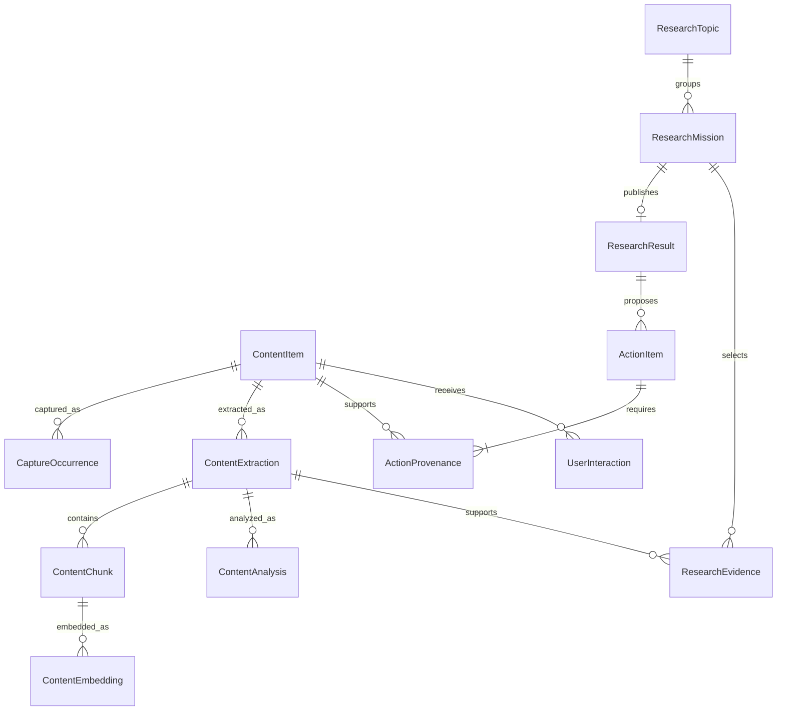

# Conceptual data model

## Implemented Catch Up storage (Task 4A)

Migration 0005 adds immutable ranking_observation and append-only user_interaction. Relational
owner/content/extraction/analysis references protect snapshot provenance. Observations retain
catch-up-v1 features, cutoff, missingness, grouping keys, exact four-class scores, displayed
class, baseline/personal mode, reasons/deadline flag, model/context identity and evaluation.
Explicit feedback references an observation; corrections name the current superseded event.
Guards reject stale corrections and labels preceding their observations. Event retries are
idempotent by event ID; only FEEDBACK_LABELED trains ranking. Reads and final observation writes
deny inactive candidates; deleted/deletion-pending training history is excluded. Numeric features
are not a privacy-erasure implementation. Source task state remains a separate future slice.

The implemented feature subset, baseline, chronological/source-group purge and personal
eligibility gates are precisely described in [RANKING_BENCHMARK](RANKING_BENCHMARK.md).
The later conceptual feature table remains design guidance, not a claim that every feature exists.

Approved conceptual model. Tasks 1B/2A/2B supply PostgreSQL intake/extraction, source-analysis runs/artifacts, immutable retrieval chunks, optional embeddings and scoped retrieval. Task 3A adds research topics/missions/evidence/results/proposals; mutable ActionItem persistence remains planned. IDs use UUIDs with distinct NewType aliases where previously defined; instants reject naive values and normalize to UTC. Deadline uncertainty remains explicit.

## Implemented retrieval storage (Task 2B)

Migration 0003 preserves 0001/0002 and adds content_chunk, retrieval_state, collection, collection_membership and content_embedding; optional embedding_vector uses native public.vector when the extension can be enabled. Extension creation failure leaves lexical schema usable; downgrade retains the shared extension. Optional vector storage is deliberately outside portable ORM metadata/drift reflection, with explicit DDL and integration tests.

ContentChunk binds owner/content/extraction, deterministic ordinal/range/page, exact text/hash and chunker configuration. UUIDv5 identity includes extraction and size/overlap/version. Chunk updates are rejected; source text/page/hash are checked at insertion. Generated simple-dictionary tsvector has a GIN index. No embedding is a citation: retrieval returns immutable chunk-to-extraction SourceEvidence.

retrieval_state adds mutable ACTIVE/ARCHIVED/DELETION_PENDING/DELETED search visibility and an explicit newest-extraction reference without changing immutable ContentItem. Indexing selects newest extraction by created_at/UUID; searches also exclude stale versions before reindexing. A newest failed extraction does not expose an older parser version. Visibility flags do not implement erasure or authentication. Historical ContentItem snapshots remain independently visible unless explicitly hidden.

Collections are minimal owner/name records plus many-to-many membership. Membership composite foreign keys enforce matching owner for both collection and source. Collection filters use union semantics and apply in both SQL search paths. They never replace the request's owner predicate.

ContentEmbedding stores owner/chunk, provider/model/revision-or-unknown, namespace, dimension, normalization, leased status/attempt/error, timing/runtime and creation time. Namespace hashes include model/revision, dimension, normalization, query instruction and embedding version. Different spaces coexist. Metadata and native vector publication are atomic and fenced; failed rows are retryable, successful ones skipped. Derived namespace deletion/rebuild is owner-scoped and cascades to native vectors. Native vector_dims must match metadata via a composite foreign key/check. No approximate index exists. Detailed behavior and benchmark results are in RETRIEVAL_BENCHMARK.md.

## Implemented intake storage (Task 1B)

Seven tables: owner_scope, intake_batch, intake_entry, content_item, capture_occurrence, content_extraction, processing_job. The initial Alembic revision is 0001. Intake batches are unique by owner/request key with a frozen input fingerprint; entry ordinals are unique within a batch. Entry outcomes are independent. Rejected uploads retain receipt metadata, not their payloads. Accepted local bytes first persist on the queued receipt; after bounded fetch where needed, snapshot/capture/saved receipt/EXTRACT job commit atomically. The successful source commit precedes extraction.

Composite foreign keys enforce owner consistency. Content uniqueness is owner + type + SHA-256 of submitted URL/external identity (or empty identity for local inputs) + raw hash. Advisory transaction locks serialize source deduplication and predecessor decisions; normalized hashes do not merge sources. New captures remain distinct. URL reversion reuses a known snapshot, and a later novel version's predecessor follows the latest capture by database recorded_at. Per-capture submitted/final URLs, fetched/captured timestamp, HTTP status and media type survive duplicate reuse. Snapshot fields remain immutable.

Extraction success/failure/unavailability is separate from SAVED intake status. Successful extractions have normalized UTF-8 hashes and deterministic page/character spans; failed/no-text PDF originals remain saved. Extraction version includes normalization policy and exact pypdf version. Immutable-update triggers protect originals, captures and completed extraction rows. Source quote existence/semantic support still requires later validation against extraction text.

Processing jobs have EXTRACT/ANALYZE kind, version, PENDING/RUNNING/SUCCEEDED/FAILED/CANCELLED status, attempts and token/expiry. An EXTRACT job references the original; ANALYZE references an extraction. Claims use owner-scoped FOR UPDATE SKIP LOCKED; completion verifies current token/version/expiry. Reclaiming an expired lease changes the token, fencing stale writes. Saving extraction outcome, completing its lease, and creating a successful-text ANALYZE placeholder are atomic. Task 2A materializes configuration-specific analysis operations from successful extractions and cancels only pending extraction-version placeholders as superseded; it does not claim they produced an analysis.

## Implemented analysis storage (Task 2A)

Migration 0002 adds processing_run, content_analysis, action_proposal and analysis_evidence. The original 0001 is preserved. Composite foreign keys carry owner/content/extraction scope through job, run, analysis and citations. Metadata needed for identity is relational; bounded generated sections and call audits use JSONB.

An operation version is `ai:<configuration SHA-256>:<extraction UUID>`, unique in the existing owner/content/kind/version key. Configuration includes provider/model/revisions-or-unknown, prompt version/hash, schema/pipeline version, generation and input budgets. Input hash is the immutable normalized extraction hash. Each lease claim creates a processing_run attempt with source IDs, identity, parameters, times, status, sanitized error and individual call/repair audit. Reclaiming closes an abandoned attempt as FAILED/LEASE_EXPIRED before starting another. Completed attempts and their identities cannot be updated. Explicit retries preserve earlier attempts; a crash may repeat model calls.

ContentAnalysis is immutable and references exactly one successful run and operation. Its version string is the stable operation identity rather than a mutable latest pointer or publication counter. Ordered chunk summaries, topics, claim/entity text/uncertainty, actionability, exact covered ranges and COMPLETE/PARTIAL coverage are stored. Evidence rows hold relational source/extraction IDs, character offsets, exact quotes, optional PDF page, role and stable statement/candidate ordinals. PostgreSQL checks quotes/pages on insertion. Deferred publication constraints require completed run/job state and evidence for claims/entities/proposals at commit. Successful analysis, evidence, proposals and run/job completion commit together.

ActionProposal is persisted separately from future mutable ActionItem state. It carries immutable title/description, kind, candidate uncertainty, raw deadline and nullable normalized date. Analysis linkage recovers the frozen ProcessingIdentity. Candidate ordinals are unique within owner/analysis. Only a low-uncertainty, explicit ISO date with no competing cited date is normalized; time-bearing, ambiguous and invalid wording stays unresolved. Exact citation validity is mechanical; claim support stays UNREVIEWED. `claim_review_cases` exposes deterministic later human-review cases without fabricating entailment labels.

## Implemented foundation (Task 1A)

The domain implements ContentItem (including original bytes and verified SHA-256), CaptureOccurrence, SourceEvidence (immutable extraction ID and character span), ProcessingIdentity, ResearchTopic, ResearchMission, ResearchResult, a pure PublicationDecision policy, ActionOrigin/ActionProposal, Deadline, and ActionItem. Other entities in the table remain conceptual. SourceEvidence is a minimal locator value, not a full ResearchEvidence persistence entity or an implemented parser. Existence, source quote matching, and cross-record owner relationships still need use-case/storage validation.

Frozen dataclasses protect ordinary in-memory mutation; collection inputs are defensively converted to tuples where used. Operational mission/task changes return replacement values via guarded methods. Constructors also support restoring valid state; persisted transition/identity checks cannot be proven without storage. Actions keep a frozen proposal while user-facing title/description/deadline/status evolve in separate revisioned snapshots. Unknown model/provider revisions are None, not invented values. No runtime validation library is needed for this subset.

`plan_publication` requires a RUNNING mission for first publication, accepts supplied versions without allocating them, rejects conflicting repeats, returns the same stored publication for identical repeat inputs, and selects Current Brief by run_sequence. Callers must supply historical existing_result even when it is not Current Brief. Terminal success requires that existing publication on retry; FAILED/CANCELLED cannot publish. Future storage must enforce unique mission results, sequence/version uniqueness, latest-state reads, and atomic mission/result/action writes. Pure tests establish policy behavior only.

## Entities and relationships

| Concept | Identity and important data | Mutability / relationships |
|---|---|---|
| Owner scope | owner_id boundary, even for a single-user local deployment | Every private record and join is scoped; authentication implementation pending |
| IntakeBatch / IntakeEntry | request idempotency key, input ordinal, input type, receipt/error, optional collection | Operational mutable receipt; batch has many independent entries; entry may resolve to existing content |
| ContentItem | id, owner, source_type, external ID where available, original title/author, original/canonical URL, published_at, captured_at, raw payload, raw hash, predecessor_id | Immutable captured source snapshot; one predecessor to many possible captures; lifecycle/deletion metadata separate from payload |
| CaptureOccurrence | content_id, entry_id, submitted URL/name, connector metadata, captured_at | Append-only provenance of each capture, including exact duplicates |
| ContentExtraction | content_id, extraction_version, normalized text, normalized hash, language, page/offset mapping, extracted_at | Immutable successful extraction; one source has many extraction versions; avoid placing parser output into raw source fields |
| ContentAnalysis | content_id, extraction_id, processing_run_id, summary, topics, entities, claims with locators, actionability, importance | Immutable successful analysis; one source has many analyses; model metadata via ProcessingRun |
| ContentChunk | extraction_id, ordinal, exact text range, page/section locator, chunker version | Immutable derived chunk; never cite a mutable latest chunk |
| ContentEmbedding | chunk_id, embedding model/revision, dimension, normalization, vector/index namespace, created_at | Rebuildable derived record; unique per chunk and embedding configuration |
| ResearchTopic | owner, title, scope description, current_result_id | Mutable continuing research subject; one topic has many missions; not inferred solely by question similarity |
| ResearchMission | topic_id, question, frozen scope/permissions/budget, baseline_result_id, run_sequence, status, stage, timestamps | Inputs immutable after start; operational status mutable; one mission produces zero or one published result |
| ResearchEvidence | mission_id, content_id, extraction_id, optional analysis_id, exact locator/quote/hash, personal/public origin, retrieved_at, relevance explanation | Immutable selected evidence snapshot once synthesis starts; many missions may cite same content through separate evidence records |
| ResearchResult | topic_id, mission_id, version, baseline_result_id, schema_version, answer sections, claim-evidence links, change set, coverage limitations, created_at | Immutable published payload, one per successful/partial mission; publication transaction assigns version |
| ActionItem | owner, immutable proposal text/deadline candidate, analysis_id or result_id, mutable user title/deadline/status, revision | One proposal can cite many evidence spans via ActionProvenance; user edits never alter original candidate |
| ActionProvenance | action_id, content_id, extraction_id, locator, optional research_evidence_id | Required source linkage, including result-derived tasks; result ID alone insufficient |
| UserInteraction | owner, event_id, content_id, optional mission/action/result IDs, type, occurred_at, recorded_at, prediction/context ID | Append-only events; corrected labels supersede earlier labels explicitly |
| ProcessingRun | owner, subject ID, stage, input hash, model/provider/revision, prompt hash/version, pipeline/schema/extraction versions, parameters, status, attempts, errors/timing | Mutable operational run; successful output immutable; rerun with changed config creates new run |
| RankingObservation | content_id, cutoff, feature schema/version, features, missingness, prediction/model version, baseline flag, class probabilities, explanation | Immutable prediction-time snapshot for honest evaluation |
| Collection / CollectionItem | owner, title; many-to-many membership | Mutable optional grouping, no required folder during intake |

CaptureOccurrence, ContentExtraction, ContentChunk, ActionProvenance, and RankingObservation are necessary to avoid losing capture history, parser versioning, citations, or evaluation context. They need not become separate domain services. Topic/entity arrays and small candidate claims can initially be validated JSON values; no global ontology or entity graph is needed. Operational dispatch receipts may share ProcessingRun storage; do not create a general event-sourced architecture.

## Lifecycle values

- IntakeEntry: QUEUED -> FETCHING -> SAVED or FAILED; retry failed input explicitly, retaining attempts. DUPLICATE is a successful disposition with content_id, not a failure. A batch summary is computed from entry outcomes.
- Content availability: ACTIVE, ARCHIVED, DELETION_PENDING, DELETED. Archiving is a reversible user decision, not deletion. Processing completeness is computed separately.
- Processing operation: PENDING -> RUNNING -> SUCCEEDED / FAILED / CANCELLED. Source-analysis ProcessingRun rows record individual RUNNING -> SUCCEEDED / FAILED / CANCELLED attempts; explicit retry/reclaim creates another row. Expired leases permit reclaim. A changed model/prompt/input creates another operation/version.
- ResearchMission: QUEUED -> RUNNING -> COMPLETED / PARTIAL / FAILED / CANCELLED. Stage is separate from status. Publication and completed/partial status commit atomically. Terminal cancellation prevents late publication.
- ResearchResult coverage: COMPLETE or PARTIAL, frozen at publication. No mutable draft is exposed as a final result; working synthesis lives under the mission/run.
- ActionItem: PROPOSED -> ACCEPTED -> COMPLETED, or DISMISSED; accepted items may be dismissed; completed/dismissed may be explicitly reopened to ACCEPTED. Optimistic revision checks avoid overwriting simultaneous user edits.
- Ranking outcome: READ, KEEP, ACT, IGNORE. Repetitive/low relevance are reason codes. No generated rank mutates archive state.

Validate transitions in the domain and constrain values in storage later. Do not add PostgreSQL enums automatically: text plus check constraints may make version evolution simpler; decide in the migration slice.

## Original data, provenance, and processing versions

Store original bytes independently from normalized text, generated summaries, and vectors. For the bounded MVP, propose raw text/binary storage in PostgreSQL; an eventual blob reference must include integrity hash and durable storage ownership, never a worker's temporary path. Source author/title/publish time may be unknown; distinguish source-supplied from inferred metadata. Keep original URL and conservative canonical URL; signed/query-sensitive URLs must not be stripped destructively.

Every factual claim cites ResearchEvidence IDs or analysis source locators. Locators refer to an immutable extraction version and exact character ranges, plus PDF page/section when available. Verify quotes against that extraction; preserve raw payload hash and extraction mapping. A live URL alone is insufficient because pages change. Cite original evidence for generated summaries, not just the summary. Keep each citation's personal/public origin and capture time visible.

Action proposal writes use a unique owner + producing analysis/result ID + stable candidate ordinal key. Freeze candidate ordinals with the validated processing output before retries. This prevents retry duplicates without treating similar wording across separate analyses/results as the same user task. A later candidate may suggest an explicit link to an existing action, preserving both origins and existing user edits.

ProcessingRun fingerprints include input identity/hash, provider, exact model identifier/revision where available, prompt hash/version, schema version, pipeline version, generation parameters, and extractor/chunker version as applicable. Record unknown provider revision as unknown, not reproducible. Retrying unchanged inputs reuses a stable operation key; reprocessing intentionally creates a new run/configuration. A convenience latest_analysis_id pointer may change, but published results retain the exact analysis/evidence IDs they used.

## Research versioning and concurrency

Topic matching is user-chosen or explicitly confirmed; similar questions must not silently merge topics. Mission creation allocates a monotonic run_sequence per topic and freezes the current result as baseline_result_id. Prior conclusions may guide retrieval, but stale evidence is not accepted solely because it appeared previously.

At publication, lock the topic, enforce unique mission_id on results, allocate the next result version, persist result/evidence/actions atomically, and complete the mission. Retried publication returns the existing result. Failed/cancelled missions allocate no result version. A result's version is publication order, not mission launch order; the UI displays both run and publication times.

Update current_result_id only when the publishing mission's run_sequence is greater than that of the current result. Thus a slow older mission finishing later creates a preserved historical version without replacing the newer request's Current Brief. Latest numeric version and Current Brief can differ and must be labeled clearly. A failed newer run leaves current unchanged. Compute "What Changed" against the frozen baseline, labeled by version; it need not be the immediately preceding publication under concurrency.

Change sets identify new/removed sources, changed source snapshots, changed supported claims/actions, and model-only processing changes. Missing evidence is not proof a claim became false. An empty-evidence mission fails with gaps rather than inventing a result. Corrections create another mission/result; never edit published claims in place. Privacy deletion is an explicit exception to retained historical availability, not a silent rewrite.

## Deduplication and source change detection

Use SHA-256 raw payload hashes for exact identity within owner and source identity where known. Include source type and source identity in the uniqueness rule: identical syndicated text from different URLs retains distinct provenance. For pasted text or uploads lacking stable source identity, identical raw bytes/type may reuse an item within the same owner while new filenames/timestamps remain CaptureOccurrences. Never deduplicate across owners. A transaction/unique constraint resolves simultaneous identical submissions without duplicate processing.

Normalized-text hashes identify possible equivalent content across encodings/extractors, scoped by normalization version; they must not silently replace raw snapshots. Near-duplicates remain separate and receive a repetitive badge. Same URL/external ID with changed raw hash creates a new snapshot linked by predecessor_id; if normalized text is unchanged, show metadata-only change where justified. ETag/Last-Modified are fetch hints, not proof of content equivalence. Failed or unchanged refresh retains the prior source and records the attempt. Public sources discovered by multiple missions can reuse the same owner's snapshot but have separate mission evidence.

## Storage, constraints, and indexes

Use standard PostgreSQL via DATABASE_URL, with explicit owner-scoped foreign keys/authorization predicates and transactional repository boundaries. Normalize fields used for identity, ownership, status, joins, dates, and uniqueness. JSON is appropriate for versioned generated sections, bounded topics/entities, feature snapshots, and noncritical connector metadata; it is harmful for hiding ownership, foreign keys, deadlines, or complete relational graphs.

Planned indexes: owner/status/captured_at for inbox; owner/source identity/raw hash for dedup; extraction full-text GIN for lexical search; topic/version and mission/result uniqueness; content/processing fingerprint; action owner/status/due time; interactions owner/content/occurred_at; evidence mission/content; chunk extraction/ordinal. JSON indexes only after a real query need. Tenant predicates must also apply to joins and exports.

pgvector stores derived vectors with a fixed embedding space per index. Begin with exact search at demo scale; add approximate indexes only after recall/latency validation. If extension installation/permissions fail, lexical retrieval remains available and UI reports semantic search unavailable. Do not serialize an opaque vector blob and claim equivalent semantic search. Track rebuild status and exclude incompatible vectors.

Migrations must be version-controlled and tested for fresh install and upgrade; extension installation is a separate capability check, not an unconditional startup failure. Prefer additive/backfilled changes and explicit cutover; no provider-specific managed-auth/storage schema coupling. Backup/restore validation and destructive-change approval precede production migration. Task 1B's initial migration implements seven intake tables; Task 2A adds four source-analysis tables in 0002. No pgvector extension is required.

## Interaction events and TabPFN features

Record ITEM_OPENED, ITEM_IGNORED, ITEM_ARCHIVED, ITEM_SAVED, ITEM_ACTED_ON, ITEM_RESURFACED, MISSION_USED_ITEM. Include context and whether the event was an explicit user action or system-derived. MISSION_USED_ITEM describes system selection, not positive user feedback. ITEM_ARCHIVED may mean "finished" rather than irrelevant; ITEM_OPENED may mean curiosity, not usefulness. ITEM_RESURFACED describes exposure. Do not turn absence of a click into IGNORE. Add explicit FEEDBACK_LABELED with READ/KEEP/ACT/IGNORE and optional superseded_event_id for reliable targets.

| Feature group | Values and cutoff rule |
|---|---|
| Content | source_type, content_age_hours, content_length, duplicate_count, has_deadline, has_action; known before prediction |
| Context | topic_similarity, mission_similarity (missing outside a mission), source_authority (explicit bounded heuristic, not inferred fact) |
| History | domain_frequency, author_frequency, opened_before, times_resurfaced, previous_topic_engagement; owner history strictly before prediction cutoff |

Version the feature schema, category encoding, missing-value handling, normalization, label policy, training-context hash, and prediction configuration. Snapshot features at prediction time; never recompute historical features using later interactions. Avoid raw author/email identifiers in remote features; per-owner counts still contain behavioral information. Unknown authority is missing, not zero quality.

Bootstrap: begin with a transparent rule baseline (explicit action/deadline evidence, user interests, recency, duplicate penalty). A separately labeled seed set can demonstrate TabPFN but must be labeled generic/demo, never personal history. Proposed eligibility gate for personal context: at least 40 explicit labels and at least 5 examples per class; this is an engineering starting point to evaluate, not a scientific sufficiency claim. Sparse or missing classes stay baseline. Do not train on the model's own classifications as user labels.

TabPFN produces four-class probabilities for ranking, not summaries, factual claims, or authority judgments. Compare against baseline on a chronological held-out set with duplicate-source groups kept together; report macro-F1, per-class recall (especially ACT), top-k usefulness, latency, and label count. Gate personalized display on measured improvement and uncertainty; do not imply that a pretrained predictor knows this user. User corrections override prediction. See [ADR 0007](ADRS/0007-tabpfn-prediction-role.md).

## Privacy and retention

Authorize every source read, retrieval, result, vector query, and export. Logs retain IDs, stage/timing and sanitized error categories, not raw content, search secrets, or private questions. Scope Gmail credentials separately when introduced; revocation stops future jobs and permits deleting prior ingested data.

Deletion first denies reads/cancels jobs, then purges original payloads, extractions, chunks/vectors, analyses, features, and evidence quotes. Remove or redact affected result payloads/actions because they may reproduce private content; retain only minimal non-content tombstones where needed for integrity. Display "source removed" and unavailable result content rather than claiming intact citations. Prevent running workers from resurrecting deleted data using ownership/deletion-generation checks. Immutable history means no ordinary edits, not indefinite retention against deletion requests. Backup retention/expiry and external-provider retention remain unresolved gates before real personal data. Exports already downloaded cannot be remotely revoked.

## Implemented mission persistence (3A)

Migration 0004 adds research_topic (owner/title/description/current pointer/counters/timestamps), research_mission (frozen question/scope/baseline/run sequence plus separate status/stage/dispatch/freeze/timestamps/failure), research_stage (immutable bounded operation receipts), research_evidence (scoped source/extraction/chunk foreign keys and exact locator/metadata payload), research_result (unique mission and topic/version, immutable brief/evidence/conflicts/changes/processing), and research_proposal (unique result/ordinal with existing domain ActionProposal provenance/deadline values).

Circular current/baseline foreign keys are deferred and owner/topic scoped. Mission/evidence guards enforce freezing; artifacts reject ordinary update/delete. Publication locks topic then mission, validates stored chunks and citations, inserts result/proposals and completes the mission atomically. Domain plan_publication remains the Current Brief policy. A slower older request can become a higher numbered historical publication without taking Current Brief. Comparison stores absent evidence as unavailable, not false. Result-specific proposal storage leaves the validated source-analysis proposal table unchanged; mutable user task persistence is still future work.
